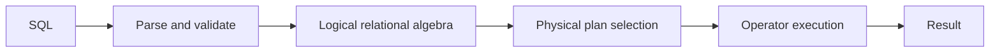

# Week 8 — Query Processing

## From SQL to result

A query execution plan chooses physical algorithms, access paths and an order
for the logical operators

## Cost model

Disk or page I/O usually dominates a simple model

Let $b_R$ be blocks in relation $R$ and $n_R$ be its tuples

| Operation | Representative alternative |
| --- | --- |
| Selection | File scan, binary search, primary index, secondary index, hash lookup |
| Projection | Scan, then sort or hash to remove duplicates |
| Join | Nested loop, block nested loop, index nested loop, sort-merge, hash join |
| Ordering | External merge sort when data exceeds memory |

The exact cost depends on buffer pages, clustering, selectivity and whether an
input is already sorted or indexed

## Selection alternatives

- a scan costs about $b_R$ block reads and works for every predicate
- a clustered index is strong for ranges because matching rows occupy nearby blocks
- an unclustered index is strongest when few records match
- a hash access path is strong for equality but cannot provide key order

## Join alternatives

### Block nested-loop join

With one outer block at a time, a rough cost is:

$$
b_R+b_Rb_S
$$

Choose the smaller relation as the outer input and use more buffer pages to
reduce repeated scans

### Index nested-loop join

For each outer tuple, probe an index on the inner join key, making it useful
when the outer input is small and the probe is selective

### Sort-merge join

Sort both inputs on the join key, then merge them, or reuse an existing order

### Hash join

Partition or build a hash table on the smaller input, then probe it with the
larger input, normally for equijoins

## Reading a plan

Read from the leaves upward and record:

1. how each base relation is accessed
2. which predicates are applied at each node
3. estimated and actual row counts
4. join algorithm and outer or build input
5. sorts, hashes, temporary results and repeated loops

The cheapest plan minimises total work, not the number of operators shown
